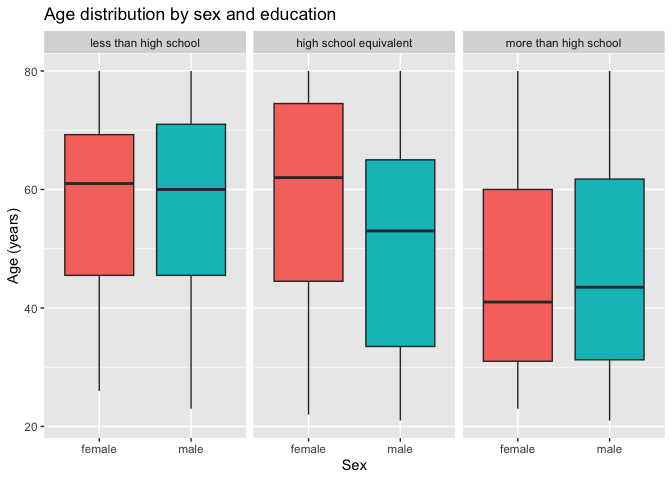

p8105_hw3_abj2136
================
2026-10-16

### loading libraries

``` r
library(tidyverse)
library(readr)
```

# Problem 2

## loading and cleaning the demographics data

``` r
demo_df = read_csv("nhanes_covar.csv",
                   na = c("", ".", "NA"),
                   skip = 4) |> 
  janitor::clean_names() |> 
  drop_na() |> 
  filter(age >= 21) |> 
  mutate(
    education = recode_values(education, 1 ~ "less than high school",
                              2 ~ "high school equivalent", 3 ~ "more than high school"),
    education = factor(education, 
                       levels = c("less than high school",
                                  "high school equivalent",
                                  "more than high school")),
    sex = recode_values(sex, 1 ~ "male", 2 ~ "female"),
    sex = as.factor(sex)
  )
```

## loading and cleaning the accelerometer data

``` r
accel_df = read_csv("nhanes_accel.csv",
                    na = c("", ".", "NA")) |> 
  janitor::clean_names() |> 
  pivot_longer(
    min1:min1440,
    names_to = "minute",
    names_prefix = "min",
    values_to = "mims_value"
  ) |> 
  mutate(minute = as.numeric(minute))
```

## merging datasets

``` r
combined_accel = left_join(demo_df, accel_df, by = "seqn")
```

## data visualizations of gender and education

``` r
# table

demo_df |> 
  count(education,sex) |>
  pivot_wider(
    names_from = sex,
    values_from = n
  ) |> 
  knitr::kable()
```

| education              | female | male |
|:-----------------------|-------:|-----:|
| less than high school  |     28 |   27 |
| high school equivalent |     23 |   35 |
| more than high school  |     59 |   56 |

``` r
# visualization

demo_df |> 
  ggplot(aes(x= sex, y = age, fill = sex)) +
  geom_boxplot() +
  facet_grid(. ~ education) +
  labs(
    title = "Age distribution by sex and education",
    x = "Sex",
    y = "Age (years)"
  ) +
  theme(legend.position = "none")
```

<!-- -->

From the table, it appears the number of males and females is relatively
equal among those with less than a high school education and more than a
high school education, and there are more males than females with a high
school equivalent education.

To visualize the data, I chose a box plot because after trying a box
plot, histogram, and density plot, I thought it was the clearest way to
see the spread of the data. Males and females with more than a high
school education have the youngest median age, while those with a high
school equivalent education are the oldest among females and those with
less than a high school education are the oldest among males. The spread
of the data is similar among those with more than or an equivalent high
school education, while the age distribution is a bit more condensed
among those with less than a high school education. Within the high
school equivalent education group the women have a notably higher median
age than men, while in the other education groups men and women have a
similar median age.
