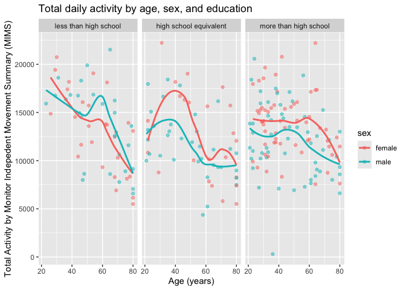
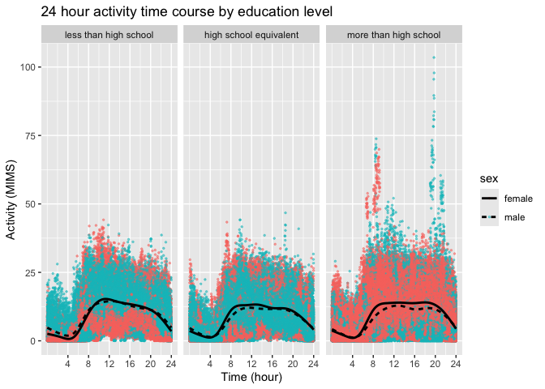
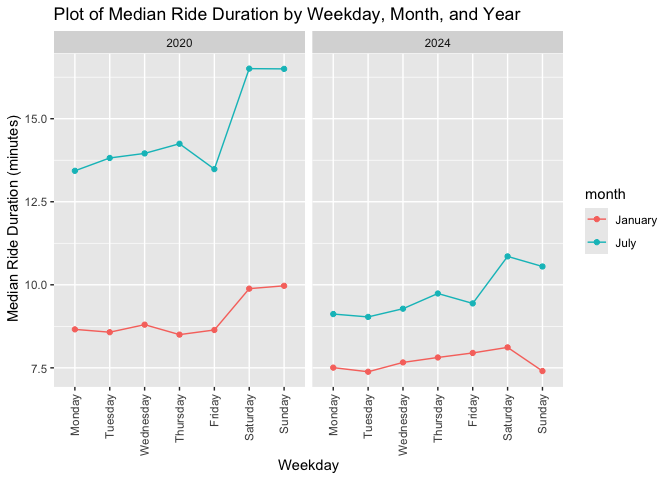
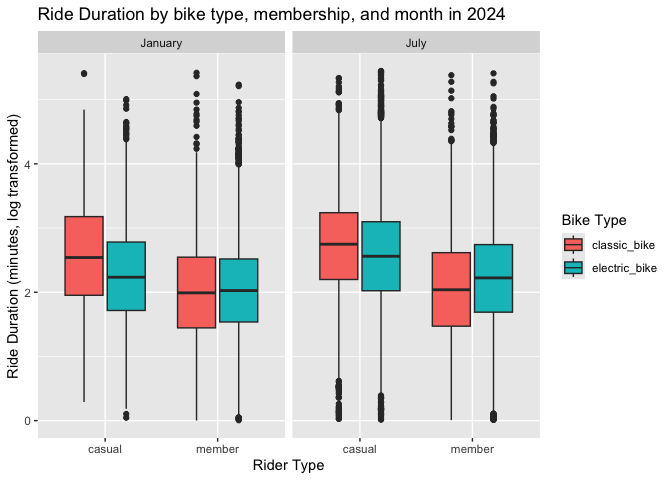

p8105_hw3_abj2136
================
2026-10-16

### loading libraries

``` r
library(tidyverse)
library(readr)
```

# Problem 2

## loading and cleaning the demographics data

``` r
demo_df = read_csv("nhanes_covar.csv",
                   na = c("", ".", "NA"),
                   skip = 4) |> 
  janitor::clean_names() |> 
  drop_na() |> 
  filter(age >= 21) |> 
  mutate(
    education = recode_values(education, 1 ~ "less than high school",
                              2 ~ "high school equivalent", 3 ~ "more than high school"),
    education = factor(education, 
                       levels = c("less than high school",
                                  "high school equivalent",
                                  "more than high school")),
    sex = recode_values(sex, 1 ~ "male", 2 ~ "female"),
    sex = as.factor(sex)
  )
```

## loading and cleaning the accelerometer data

``` r
accel_df = read_csv("nhanes_accel.csv",
                    na = c("", ".", "NA")) |> 
  janitor::clean_names() |> 
  pivot_longer(
    min1:min1440,
    names_to = "minute",
    names_prefix = "min",
    values_to = "mims_value"
  ) |> 
  mutate(minute = as.numeric(minute))
```

## merging datasets

``` r
combined_accel = left_join(demo_df, accel_df, by = "seqn")
```

## data visualizations of gender and education

``` r
# table

demo_df |> 
  count(education,sex) |>
  pivot_wider(
    names_from = sex,
    values_from = n
  ) |> 
  knitr::kable()
```

| education              | female | male |
|:-----------------------|-------:|-----:|
| less than high school  |     28 |   27 |
| high school equivalent |     23 |   35 |
| more than high school  |     59 |   56 |

``` r
# visualization

demo_df |> 
  ggplot(aes(x= sex, y = age, fill = sex)) +
  geom_boxplot() +
  facet_grid(. ~ education) +
  labs(
    title = "Age distribution by sex and education",
    x = "Sex",
    y = "Age (years)"
  ) +
  theme(legend.position = "none")
```

<!-- -->

From the table, it appears the number of males and females is relatively
equal among those with less than a high school education and more than a
high school education, and there are more males than females with a high
school equivalent education.

To visualize the data, I chose a box plot because after trying a box
plot, histogram, and density plot, I thought it was the clearest way to
see the spread of the data. Males and females with more than a high
school education have the youngest median age, while those with a high
school equivalent education are the oldest among females and those with
less than a high school education are the oldest among males. The spread
of the data is similar among those with more than or an equivalent high
school education, while the age distribution is a bit more condensed
among those with less than a high school education. Within the high
school equivalent education group the women have a notably higher median
age than men, while in the other education groups men and women have a
similar median age.

## aggregated minutes

``` r
combined_accel |> 
  group_by(seqn, sex, age, education) |> 
  summarize(total_mims = sum(mims_value)) |> 
  ggplot(aes(x = age, y = total_mims, color = sex)) +
  geom_point(alpha = .5) +
  geom_smooth(se = FALSE) +
  facet_grid(. ~ education) +
  labs(
    title = "Total daily activity by age, sex, and education",
    x = "Age (years)",
    y = "Total Activity (MIMS)"
  )
```

    ## `summarise()` has regrouped the output.
    ## `geom_smooth()` using method = 'loess' and formula = 'y ~ x'
    ## ℹ Summaries were computed grouped by seqn, sex, age, and education.
    ## ℹ Output is grouped by seqn, sex, and age.
    ## ℹ Use `summarise(.groups = "drop_last")` to silence this message.
    ## ℹ Use `summarise(.by = c(seqn, sex, age, education))` for per-operation
    ##   grouping (`?dplyr::dplyr_by`) instead.

<!-- -->

Across all three education levels, total activity decreases as age
increases. There is a steeper decrease among those with less than a high
school education, while the other two education groups have flatter
slopes. Among those with less than a high school education there is a
slight increase in activity around those aged 60, among those with a
high school equivalent there is an increase in activity from those aged
20 to those aged 40 (most notable among women), and then activity
decreases, and among those with more than a high school education total
activity generally decreases from 20 to 80, with a small bump among men
aged 50 and women aged 60. Generally among education groups, men and
women follow a similar pattern, but among those with less than a high
school education the men typically have higher total activity (after age
40), while women have higher total activity among the other two
education groups.

## 24 hr activity

``` r
combined_accel |> 
  ggplot(aes(x = minute, y = mims_value, color = sex)) +
  geom_point(alpha = .5, size = .5) +
  geom_smooth(aes(linetype = sex), se = FALSE, color = "black") +
  facet_grid(. ~ education) +
  scale_x_continuous(
    breaks = c(240, 480, 720, 960, 1200, 1440),
    labels = c("4", "8", "12", "16", "20", "24")
  ) +
  labs(
    title = "24 hour activity time course by education level",
    x = "Time (hour)",
    y = "Activity (MIMS)"
  )
```

    ## `geom_smooth()` using method = 'gam' and formula = 'y ~ s(x, bs = "cs")'

<!-- -->

I changed the trend lines from the colors associated with sex to black
because otherwise the lines blended into the points and the trend wasn’t
visible.

Based on the graph, activity thoughout the day is simialr across sex and
education level. Activity, measured by MIMS,reaches its lowest point
around hour 4 of the day (4 am), and then begins to increase. Activity
among all groups peaks between 8-10 am and then remains relatively
constant until hour 20 (8 pm), then it decreases to about the same level
as hour 0. This makes sense, as people are sleeping in the overnight and
moving around during the day.

# Problem 3

## importing and cleaning datasets

``` r
# Jan 2020

jan_2020_citi = read_csv("citibike/Jan 2020 Citi.csv",
                         na = c("", ".", "NA")) |> 
  janitor::clean_names() |> 
  mutate(year = 2020, month = "January")

# Jan 2024

jan_2024_citi = read_csv("citibike/Jan 2024 Citi.csv",
                         na = c("", ".", "NA")) |> 
  janitor::clean_names() |> 
  mutate(year = 2024, month = "January")

# July 2020

july_2020_citi = read_csv("citibike/July 2020 Citi.csv",
                          na = c("", ".", "NA")) |> 
  janitor::clean_names() |> 
  mutate(year = 2020, month = "July")

# July 2024

july_2024_citi = read_csv("citibike/July 2024 Citi.csv",
                          na = c("", ".", "NA")) |> 
  janitor::clean_names() |> 
  mutate(year = 2024, month = "July")
```

## combining data sets

``` r
total_citi = bind_rows(jan_2020_citi, jan_2024_citi, july_2020_citi, july_2024_citi) |> 
  mutate(
    weekdays = factor(weekdays,
                levels = c("Monday", "Tuesday", "Wednesday", "Thursday",
                           "Friday", "Saturday", "Sunday")),
    month = factor(month,
                   levels = c("January", "July")),
    member_casual = as.factor(member_casual),
    rideable_type = as.factor(rideable_type)
    ) |> 
  relocate(year, month)
```

Rather than merge all four data sets, I binded the rows because all the
data sets contain the same variables, just from different time points.
The resulting data set includes all the variables from each individual
file, plus a month and year variable to distinguish which file it came
from. The variables are: year, month, ride_id, rideable_type, weekdays,
duration, start_station_name, end_station_name, member_casual. There are
99485 total observations.

## total rides per time period

``` r
total_citi |> 
  count(year, month, member_casual) |> 
  pivot_wider(
    names_from = member_casual,
    values_from = n
  ) |> 
  knitr::kable()
```

| year | month   | casual | member |
|-----:|:--------|-------:|-------:|
| 2020 | January |    984 |  11436 |
| 2020 | July    |   5637 |  15411 |
| 2024 | January |   2108 |  16753 |
| 2024 | July    |  10894 |  36262 |

There are more rides in January 2024 compared to January 2020, and there
are more rides in July 2024 compared to July 2020. Within each year,
there more rides in July compared to January, which makes sense as it is
warmer in July so people are more likely to choose an outdoor form of
transportation. Citi bike memberships also appear to have become more
popular over time, as the number of member rides also increased from Jan
2020 to July 2024. There is an increase of about 20,000 member rides
from Jan 2024 to July 2024 compared to an increase of about 9,000 among
casual rides in that same time period.

## 5 most popular starting stations

``` r
total_citi |> 
  filter(year == 2024, month == "July") |> 
  count(start_station_name,) |> 
  arrange(desc(n)) |> 
  slice_head(n = 5) |> 
  knitr::kable(col.names = c("Starting Station", "Number of Rides"))
```

| Starting Station         | Number of Rides |
|:-------------------------|----------------:|
| Pier 61 at Chelsea Piers |             163 |
| University Pl & E 14 St  |             155 |
| W 21 St & 6 Ave          |             152 |
| West St & Chambers St    |             150 |
| W 31 St & 7 Ave          |             146 |

## plot of median ride duration

``` r
total_citi |> 
  group_by(weekdays, month, year) |> 
  summarize(median_duration = median(duration)) |> 
  ggplot(aes(x = weekdays, y = median_duration, color = month, group = month )) +
  geom_point() +
  geom_line() +
  facet_grid(. ~ year) +
  theme(axis.text.x = element_text(angle = 90, hjust = 1, vjust = 0.5))
```

    ## `summarise()` has regrouped the output.
    ## ℹ Summaries were computed grouped by weekdays, month, and year.
    ## ℹ Output is grouped by weekdays and month.
    ## ℹ Use `summarise(.groups = "drop_last")` to silence this message.
    ## ℹ Use `summarise(.by = c(weekdays, month, year))` for per-operation grouping
    ##   (`?dplyr::dplyr_by`) instead.

<!-- -->

From these plots, it appears the median duration of rides has decreased
from 2020 to 2024 in both January and July. The higher ride durations on
2020, especially during July may be due to the height of the Covid-19
pandemic, where people were less likely to be in enclosed spaces like
the subway with other people, so biking was preferred and safer. In both
years, the median ride duration is longer in July than January, which
may be due to the warmer temperatures in July encouraging people to take
outdoor transportation. Median ride length is relatively constant across
Monday-Friday (people may take shorter rides to commute to/from work),
while the ride length increases during the weekend for all months except
January 2024.

## 2024 citi bikes

``` r
total_citi |> 
  filter(year == 2024) |> 
  mutate(log_ride = log(duration)) |> 
  ggplot(aes(x = member_casual, y = log_ride, fill = rideable_type)) +
  geom_boxplot() + 
  facet_grid(. ~ month) +
  labs(
    title = "Ride Duration by bike type, membership, and month in 2024",
    x = "Rider Type",
    y = "Ride Duration (minutes, log transformed)",
    fill = "Bike Type"
  )
```

<!-- -->

Median ride duration appears relatively equal among members across both
bike types in January and July, although the median ride duration is
slightly higher for electric bike riders with memberships in July.
Median ride duration is higher among casual riders than members across
both months and ride types, and among these casual riders those using
classic bikes have a slightly higher median ride duration.
